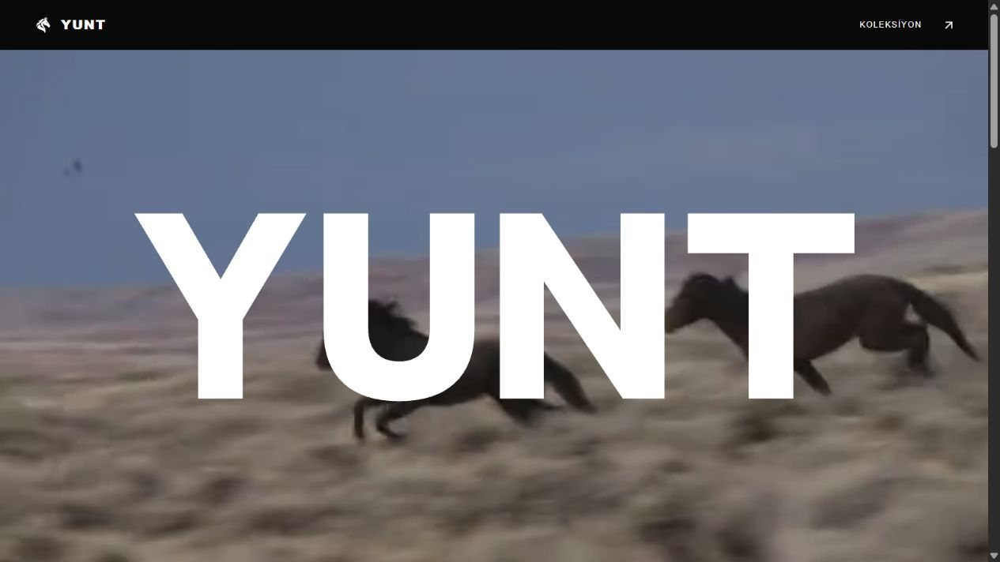
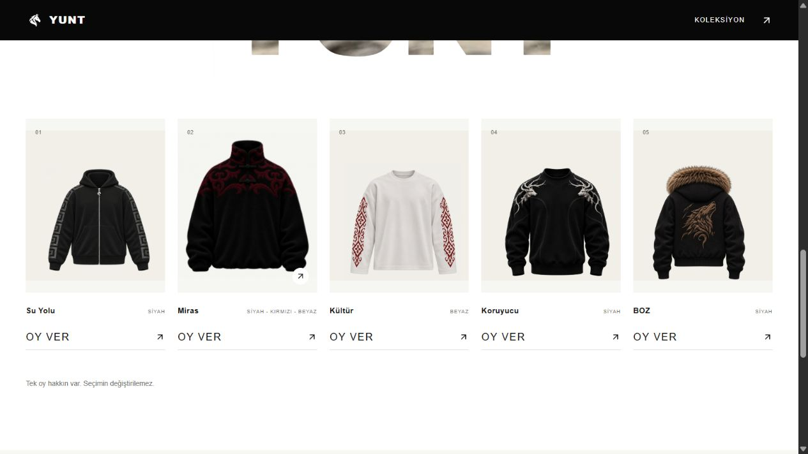

# YUNT Wear

Koleksiyon oylaması, isteğe bağlı haber listesi ve yönetim paneli sunan giyim markası web uygulaması.

**Canlı site:** [yunt.yunt.workers.dev](https://yunt.yunt.workers.dev/)




## Ne yapıyor?

- Tasarımları ürün sayfaları ve görsel galerileriyle tanıtır.
- Ziyaretçinin bir tasarıma oy vermesini, ardından isteğe bağlı haber listesine katılmasını sağlar.
- Yönetim panelinden ürün, medya, taslak ve yayımlanmış içerik düzenlenir.
- Yetkili panelde oy dağılımı, kayıtlar ve ziyaret raporları gösterilir.

## Kullanılan teknolojiler

React, TypeScript, Tailwind CSS ve GSAP. Next.js uygulama yapısı Cloudflare'da Vinext ile çalıştırılır. Güncel yayında Cloudflare Workers sunucu kodunu, D1 verileri, R2 yüklenen medyayı saklar. Kaynakta önceki Netlify sürümü için Next.js, PostgreSQL ve Blobs uyarlaması da bulunur; bunlar aynı veritabanı değildir.

## Nasıl çalışır?

Tarayıcı oy isteğini sunucu API'sine gönderir. Sunucu ziyaretçi çereziyle ilişkilendirilmiş kimliği kontrol eder ve oyu D1'e yazar. Aynı oy tekrar gönderildiğinde yeni oy oluşmaz; farklı seçime ikinci oy reddedilir. Çerez silinmesi veya farklı cihaz kullanımı nedeniyle bu mekanizma kişi başına kesin kimlik doğrulaması değildir.

Oy sonrası ad, e-posta ve açık onayla haber listesi kaydı oluşturulabilir. Kayıt ve %20 indirim hakkı saklanır; otomatik e-posta gönderimi veya ödeme/indirim kullanımı bağlı değildir. Yönetim paneli sunucuda doğrulanan parola ve süreli oturumla korunur. Ziyaretçiler için hesap açılması gerekmez.

## Yerel çalıştırma

Node.js 22.13 veya üzeri ve pnpm 11.25:

```sh
pnpm install --frozen-lockfile
node scripts/create-local-secrets.mjs
pnpm build:cloudflare
node scripts/init-local-db.mjs
pnpm start
```

Wrangler'ın terminalde gösterdiği yerel adresi aç. `create-local-secrets.mjs` yalnız kendi yerel parolanı ve oturum sırrını oluşturur; `.dev.vars` ve `local-admin.txt` Git dışında kalır. Varsayılan yönetici adı giriş ekranında kullanılır. Gerçek üretim verileri veya erişim bilgileri bu depoda yoktur.

Geliştirme sunucusu: `pnpm dev:cloudflare` (5173). Yerel veritabanı hazırlama betiği derlenmiş Wrangler yapılandırmasını ve `--local` seçeneğini kullanır; uzak veritabanına yazmaz. Yerel durum dizinleri Git dışında tutulur.

## Yayın ve yapılandırma

Kendi Cloudflare hesabında ayrı D1 ve R2 kaynakları oluştur; `DB` ve `BUCKET` bağlarını tanımla. Önce `drizzle/`, sonra `cloudflare/migrations/` SQL dosyalarını dosya adı sırasıyla uygula. `scripts/cloudflare-config.mjs` derlemeden sonra kendi D1 kimliğin, HTTPS adresin ve kova adınla yayın yapılandırmasını üretir. Yönetici parola özetini ve en az 32 karakterlik `YUNT_SESSION_SECRET` değerini Workers secrets olarak ayarla; `YUNT_PUBLIC_ORIGIN` kendi yayın adresin olmalıdır. Örnek yerel sırları üretime kopyalama.

Üretim verileri, içerik değişiklikleri ve medya yüklemeleri depoya dahil değildir. Kaynak başlangıç içeriği, panelden düzenlenen canlı içerikten farklı olabilir. Üretim yayını bu depoyu hazırlarken değiştirilmedi.

## Doğrulama

`pnpm typecheck` TypeScript denetimini, `pnpm build:cloudflare` üretim derlemesini çalıştırır. Bu hazırlıkta yapılan kontrollerin sonucu `VALIDATION.md` içindedir; canlı siteye test oyu veya haber listesi kaydı gönderilmedi.

## Yapay zekâ kullanımı

Yapay zekâ destekli geliştirme araçlarıyla geliştirildi. Tasarım, içerik, özellik kapsamı ve revizyonlar tarafımdan yönlendirildi; kod üretimi ve hata çözümünde bu araçlardan yararlanıldı. Aşağıdaki doğrulama notları bu GitHub sürümünün hazırlığına aittir. Marka yönü, kıyafet tasarımları ve arayüz revizyonları tarafımdan belirlendi. Bazı tanıtım görselleri yapay zekâ araçlarıyla üretildi.
